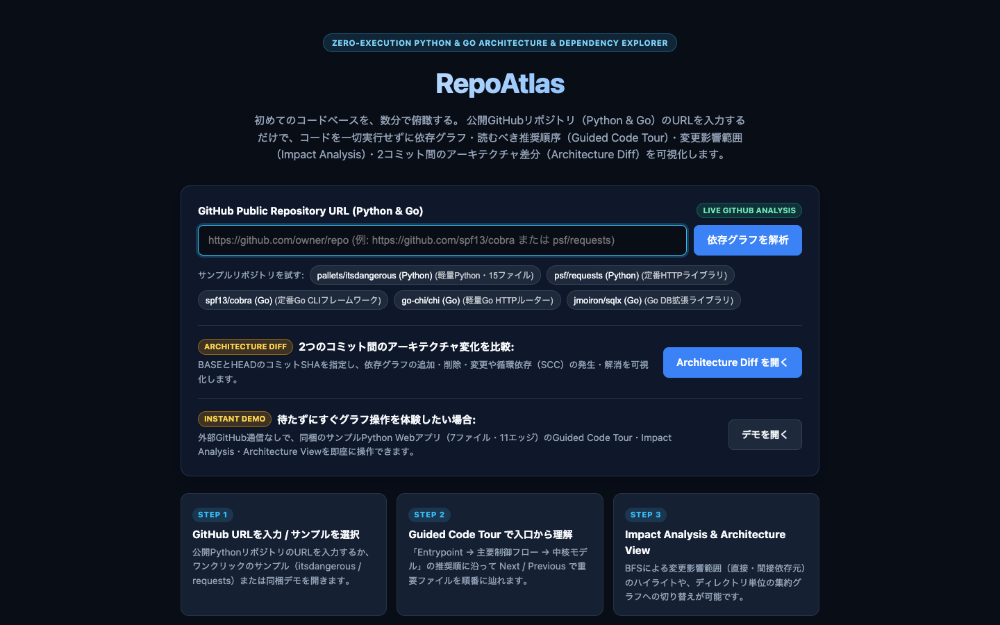
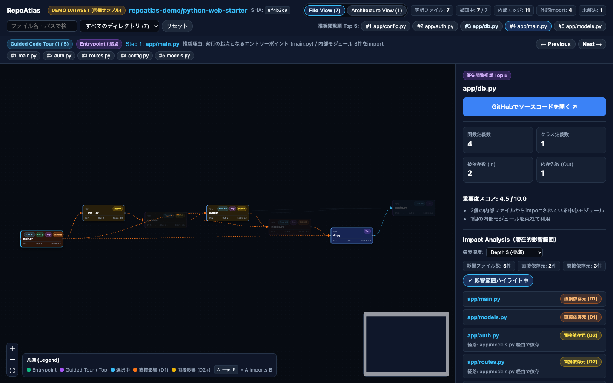
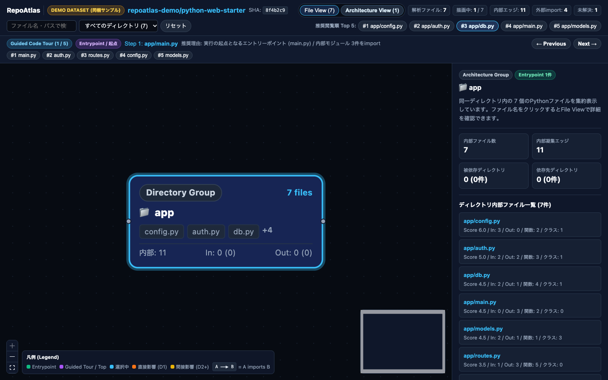
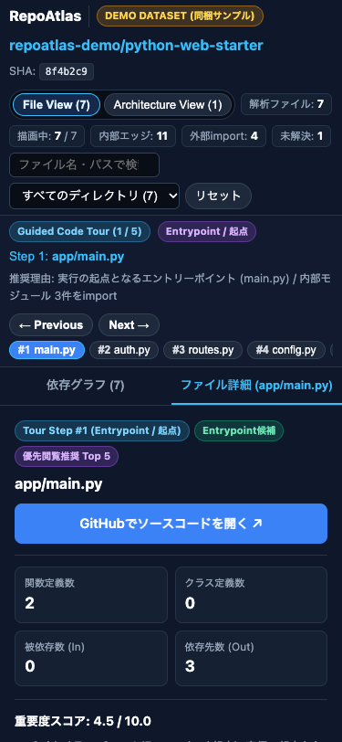
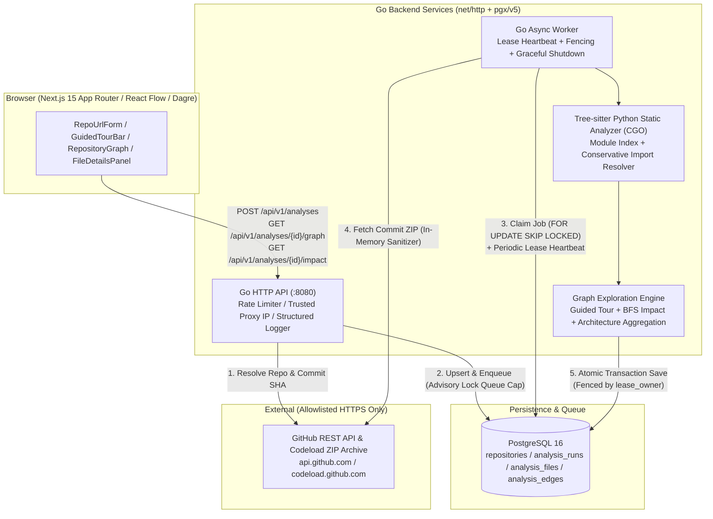

# RepoAtlas — Zero-Execution Python Codebase & Dependency Explorer

<div align="center">

[](YOUR_URL_HERE)
[](LICENSE)
[](backend/go.mod)
[](frontend/package.json)
[](docs/03-database.md)

### URL 👉 **https://web-production-6e4cf.up.railway.app/**

</div>

---

**RepoAtlas** は、公開 GitHub リポジトリ（Python）の URL を入力するだけで、**リポジトリ内のコードを一切実行せずに静的解析**し、ファイル間の依存関係グラフ・最初に読むべき推奨順序（**Guided Code Tour**）・変更時の潜在的影響範囲（**BFS Impact Analysis**）・ディレクトリ単位のアーキテクチャ構造（**Architecture View**）をブラウザ上でインタラクティブに探索できる Web アプリケーションです。

---

## 1. プロダクト概要と解決したい課題

### 解決したい課題
初見の OSS やチームの大規模な Python リポジトリを読み始める際、開発者はしばしば以下の課題に直面します。

1. **「どのファイルから読めばよいか分からない」**：ディレクトリツリーを上から順に開いても、設定ファイルやユーティリティばかりが目に入り、実際のエントリーポイントや主要な制御フローになかなか辿り着けない。
2. **「このファイルを変更したらどこに波及するか分からない」**：あるモジュールを修正する際、直接 `import` しているファイルだけでなく、2 ホップ・3 ホップ先の間接的な依存元を手作業の grep で追跡するのは困難。
3. **「不審・未知のリポジトリをローカルで実行したくない」**：動的解析ツールや `setup.py` / `pip install` を伴うツールは任意コード実行のリスクがある。

### RepoAtlas のアプローチ
RepoAtlas は **「ゼロ実行（Zero-Execution）」** と **「決定論的グラフアルゴリズム」** を組み合わせ、対象コミット SHA の ZIP アーカイブをインメモリ制限下で安全に展開し、Go + Tree-sitter による構文木解析とグラフ探索によって、数秒でコードベースの地図を生成します。

---

## 2. 主要機能

- **Guided Code Tour（推奨閲覧順序の自動生成）**
  - 単なる被依存数ランキングではなく、**「Entrypoint / 公開 API 境界 → 主要制御フロー（Orchestrator） → 中核モデル・共有基盤（Core / Foundation）」** の 3 段階ヒューリスティックで 5〜10 件の推奨閲覧順序と理由を決定論的に生成。`← Previous` / `Next →` で順番にコードベースを辿れます。
- **Impact Analysis（BFS による変更影響範囲解析）**
  - 任意のファイルを選択すると、逆方向 `import` エッジを **幅優先探索（BFS）** して直接依存元（Depth 1）と間接依存元（Depth 2+）を算出。循環依存（`A ⇄ B` 等）に対する無限ループ防止と最大探索深度の切り替え、キャンバス上の影響経路ハイライトを備えています。
- **Architecture View（ディレクトリ集約グラフ）**
  - ファイル単位の `File View` とディレクトリ単位に集約した `Architecture View` をワンクリックで切り替え可能。数百ファイル規模のリポジトリでもパッケージ間の結合度（import 件数）と内部凝集度を即座に俯瞰できます。
- **正確なコミットスナップショット & キャッシュ**
  - 解析時点のデフォルトブランチ先端コミット SHA（40 文字）を固定し、各ノードから `https://github.com/{owner}/{repo}/blob/{commit_sha}/{path}` へ直接ジャンプ可能。同一 `(repository_id, commit_sha, analyzer_version)` の再リクエスト時は PostgreSQL キャッシュから即座に返却します。

---

## 3. スクリーンショット

| トップ画面（1440px デスクトップ） | 依存グラフ & Guided Code Tour（File View） |
| --- | --- |
|  |  |

| Architecture View（ディレクトリ集約） | モバイル表示（375px・Impact Analysis タブ） |
| --- | --- |
|  |  |

---

## 4. アーキテクチャ図



---

## 5. 技術スタック

| レイヤー | 技術 / ライブラリ | 採用理由 |
| --- | --- | --- |
| **Frontend** | Next.js 15 (App Router), React 19, TypeScript | 型安全な UI 構築と SSR / Static ルーティングの両立 |
| **Graph Visualization** | `@xyflow/react` (React Flow v12), `@dagrejs/dagre` | カスタムノード描画、階層型 DAG 自動レイアウト、ズーム・ミニマップ制御 |
| **Backend API & Worker** | Go 1.25 (`net/http`, `log/slog`), `jackc/pgx/v5` | 単一バイナリ展開、低メモリフットプリント、高並行性、標準ライブラリ中心の堅牢な HTTP 実装 |
| **Static Analysis** | `tree-sitter/go-tree-sitter`, `tree-sitter-python` (CGO) | Python ランタイム不要で構文エラー耐性の高い高速 CST パース |
| **Database & Queue** | PostgreSQL 16 | RDB トランザクションと `FOR UPDATE SKIP LOCKED` による外部ブローカー不要の信頼性の高いジョブキュー |
| **Testing** | Go `testing` (`-race`), `embedded-postgres`, Vitest, Playwright | ユニット・実 PostgreSQL 統合・ブラウザ E2E までの全層自動検証 |

---

## 6. ローカル起動方法

### 方法 A：Docker Compose で一括起動（推奨）

```bash
cp .env.example .env
# 任意: GitHub API の匿名レート制限 (60 req/hr) を緩和する場合は .env の GITHUB_TOKEN を設定

docker compose up --build
```

- **Web UI**: `http://localhost:3000`
- **同梱デモ画面（通信不要）**: `http://localhost:3000/demo`
- **Go API Health Check**: `http://localhost:8080/healthz`

### 方法 B：ホスト環境で個別プロセスとして起動

> **CGO に関する注意**: `backend` は `go-tree-sitter` を利用するため、`CGO_ENABLED=1` および C コンパイラ（macOS の Xcode Command Line Tools、Linux の `gcc` + `libc6-dev`）が必要です。

```bash
# 1. Backend API の起動 (DATABASE_URL=memory 指定時はインメモリストア + 内蔵Workerで単体動作可能)
cd backend
DATABASE_URL=memory MOCK_GITHUB_FIXTURE_DIR=./testdata go run ./cmd/api

# 2. Frontend の起動
cd ../frontend
npm install
npm run dev
```

---

## 7. テスト方法

```bash
# 1. Go 静的解析 (go vet) & 全ユニットテスト (Race Detector 有効)
go -C backend vet ./...
go -C backend test -race -p 1 ./...

# 2. 実 PostgreSQL 16 統合テスト (embedded-postgres により実 PostgreSQL 16.9 を自動起動して検証)
REQUIRE_POSTGRES_TEST=1 go -C backend test -v -run TestPostgresIntegration_FullSuite ./internal/store

# 3. 実 GitHub API + 実 PostgreSQL 16 End-to-End テスト (pallets/itsdangerous & psf/requests)
RUN_REAL_GITHUB_E2E=1 go -C backend test -v -run TestRealGitHubEndToEnd_ItsDangerousAndRequests ./internal/httpapi

# 4. Frontend 型チェック・ユニットテスト・パフォーマンス測定・Production Build
npm --prefix frontend run lint
npm --prefix frontend run typecheck
npm --prefix frontend run test
npm --prefix frontend run build

# 5. Playwright ブラウザ E2E テスト (オフライン E2E + 3画面サイズ検証 + 実 GitHub E2E)
RUN_REAL_GITHUB_E2E=1 npm --prefix frontend run test:e2e
```

---

## 8. 技術的な工夫（設計ハイライト）

### 8.1 Go + Tree-sitter によるゼロ実行静的解析
- リポジトリ内の Python コード（`setup.py` 等を含む）は一切実行せず、メモリ上で展開した `.py` バイト列を `go-tree-sitter` で構文解析し、`import_statement` / `import_from_statement` / トップレベルおよびネスト内の `function_definition` / `class_definition` を抽出します。

### 8.2 Python import の保守的な依存解決
- リポジトリルート（`.`）および直下の `src/` ディレクトリをソースルート候補としてモジュールインデックス（`pkg.mod` $\to$ `pkg/mod.py` または `pkg/mod/__init__.py`）を構築します。
- 相対 import（`from . import x`, `from ..sub import y`）は呼び出し元ファイルのパッケージ階層から解決します。
- **曖昧性の排除**：ルート直下と `src/` 配下に同一モジュールパスが存在して一意に定まらない場合や、対象ファイルが存在しない相対 import は無理に補完せず `unresolved` として記録し、**虚偽の内部エッジを生成しない保守的設計**としています。

### 8.3 PostgreSQL による非同期ジョブキューと排他制御
- 外部メッセージブローカー（Redis / RabbitMQ 等）を増やさず、PostgreSQL の `FOR UPDATE SKIP LOCKED` を用いて複数 Worker からの競合なきジョブ取得を実現しています。
- 同一 `(repository_id, commit_sha, analyzer_version)` への同時 POST は `ON CONFLICT DO NOTHING` で単一ジョブへ収束させ、新規ジョブ投入時の待機数上限（`MAX_QUEUED_JOBS`）チェックにはトランザクションスコープの Advisory Lock（`pg_advisory_xact_lock`）を併用することで、`READ COMMITTED` 分離レベル下でも並行リクエストが上限を突破しないよう保証しています。

### 8.4 リース・定期ハートビート・`lease_owner` フェンシング
- Worker がジョブを取得する際、一意な所有権トークン `lease_owner` と有効期限 `lease_expires_at`（初期 120 秒）を設定します。
- 解析処理中はバックグラウンド goroutine が定期的に `ExtendAnalysisLease` でハートビートを送ります。
- 万一ネットワーク分断や GC 一時停止でリースが期限切れとなり別 Worker がジョブを再取得（最大 `attempt_count < 3`）した場合、古い Worker が後から `CompleteAnalysis` を呼んでもトランザクション内の `SELECT lease_owner, status FROM analysis_runs WHERE id = $1 FOR UPDATE` によって `ErrLeaseLost` として拒否され、**古い Worker による結果の上書き（スプリットブレイン）を完全に防止**します。

### 8.5 グラフアルゴリズム・計算量・パフォーマンス測定結果
- **Guided Code Tour**：Phase 1（Entrypoint 選出）$\to$ 順方向 BFS による起点からの最短距離算出 $O(V + E)$ $\to$ Phase 2（Orchestrator 選出）$\to$ Phase 3（Core / Foundation 選出）の 3 段階アルゴリズム。計算量はソートを含め $O(V \log V + E)$。
- **Impact Analysis**：逆方向隣接リスト上の幅優先探索（BFS）。`visitedDepth` により循環依存を含む任意のグラフで $O(V + E)$ 時間・無限ループなしを保証。
- **Frontend レイアウト最適化**：
  - 初期描画上限を重要度上位 **300 ノード**に制限し、80 ノード超のグラフでは Dagre の異常な長大ランク連鎖を抑止する有界ランクエッジ供給（`ranker: "tight-tree"`）を適用。
  - さらに **Dagre による座標計算（`computeDagreNodePositions`）と選択・影響ハイライト適用（`applyGraphVisualState`）を分離してメモ化**し、ノード選択時や Impact 探索深度変更時の Dagre 再計算をゼロにしました。

#### 実測パフォーマンス（`frontend/__tests__/performance.test.ts` 実測値）

| リポジトリ規模 | 総エッジ数 | 描画ノード数 (File View) | 集約ディレクトリ数 (Arch View) | データ生成 (Tour + Arch + BFS Impact) | 検索・フィルタ処理 | 改善前：選択時 / 初期レイアウト | 改善後：初期レイアウト | 改善後：ノード選択・ハイライト更新 | Architecture View レイアウト |
| ---: | ---: | ---: | ---: | ---: | ---: | ---: | ---: | ---: | ---: |
| **50 files** | 75 | 50 | 5 | 5.79 ms | 0.10 ms | 43.14 ms | 49.07 ms | **0.24 ms** | 2.99 ms |
| **300 files** | 450 | 300 | 12 | 1.83 ms | 0.09 ms | 270.43 ms | **58.92 ms** (4.6x 高速化) | **0.16 ms** (~1,690x 高速化) | 4.12 ms |
| **1,000 files** | 1,500 | 300 (上限適用) | 40 | 5.15 ms | 0.76 ms | 12.21 ms (上限適用後) | **8.52 ms** | **0.06 ms** | 27.68 ms |

### 8.6 GitHub API・ZIP 取得時の多層セキュリティ対策
- **SSRF 防御**：入力 URL は `https://github.com/{owner}/{repo}` のみを厳格にパースし、通信先は許可リスト（`api.github.com`, `codeload.github.com` 等）の HTTPS のみに限定。リダイレクト毎に行き先ホストを検証し、別ホストへのリダイレクト時は `Authorization` ヘッダを自動破棄します。
- **ZIP サニタイズ**：圧縮サイズ上限 `50 MiB`、展開後合計上限 `100 MiB`、単一 `.py` 上限 `1 MiB`、Python ソース合計 `20 MiB`、最大 `.py` ファイル数 `2,000 件` を強制。パストラバーサル（`..`）や `.py` シンボリックリンクを検出した時点で拒否します。
- **秘密情報のマスク**：`log/slog` のカスタム属性置換により、`ghp_*` / `github_pat_*` / `Bearer` トークンが構造化ログへ出力されるのを自動ブロックします。

---

## 9. 既知の制約

1. **静的 import 解析の範囲**：
   - `importlib` による動的 import、文字列指定のプラグイン・ルーティング、DI コンテナ、実行時の条件分岐やリフレクションは静的 import グラフに含まれません。
   - Impact Analysis はファイル単位の import グラフ上の到達可能性（潜在的影響範囲）を示すものであり、シンボル単位の実使用や実行時の影響有無を保証するものではありません。
2. **IP レート制限のスコープ**：
   - `POST /api/v1/analyses` の IP レート制限（`IPRateLimiter`）は API プロセス内のメモリ上でスライディングウィンドウ管理を行っています。そのため、API コンテナを複数レプリカに水平スケールさせる場合は、前段のリバースプロキシ（Cloudflare / ALB / Nginx）または Redis ベースの分散レート制限を併用する必要があります（一方、`MAX_QUEUED_JOBS` による待機ジョブ数上限は PostgreSQL の Advisory Lock により複数 API プロセス間でも厳密に共有されます）。

---

## 10. 今後の改善予定（Roadmap）

- **シンボル単位（関数・クラス）の Call / Reference グラフ**：ファイル内のどの関数・クラスが import されているかまでの細粒度 Impact Analysis
- **コミット間 Diff 解析**：2 つのコミット SHA 間で追加・削除された依存エッジのハイライト
- **マルチ言語対応**：Tree-sitter Go / TypeScript パーサの追加によるポリグロットリポジトリ解析

---

## 11. ライセンス

本プロジェクトは [MIT License](LICENSE) のもとで公開されています。

