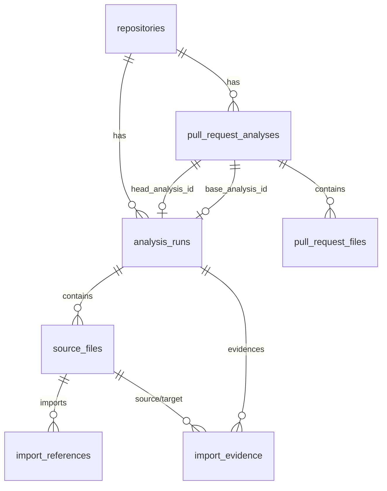

# RepoAtlas Phase 5 設計書
## PR Impact Analysis & Explainable Static Analysis

本書は、RepoAtlas Phase 5 における「Pull Request Impact Analysis（PR変更影響解析）」「Explainable Dependency Graph（依存関係の根拠表示）」「Static Analysis Evaluation（静的解析精度の定量評価）」の実装方針とアーキテクチャ設計を定義する仕様の正本です。

---

## 1. 全体方針と設計原則

### 1.1 既存アーキテクチャの最大再利用
- **解析エンジンの単一性**: PR 専用の別個の Python 解析エンジンは作成せず、既存の Tree-sitter CGo パイプライン（`backend/internal/analyzer`）を共有します。
- **コミット固定とキャッシュ**: PR の解析対象は、ブランチ名ではなく GitHub PR の `head.sha`（40文字SHA）を固定して行います。同一コミット SHA のリポジトリ解析結果が存在する場合はキャッシュ（`cached: true`）を再利用します。
- **アナライザーバージョンの更新**: Phase 5 で Tree-sitter から詳細な証拠情報（行・列・解決理由）を取得する拡張に伴い、`ANALYZER_VERSION` を `v1.0.0` から `v2.0.0` に引き上げます。これにより、証拠情報を持たない古い解析キャッシュが誤って混在することを防ぎます。

### 1.2 非同期ジョブキュー基盤の共有
- リポジトリ解析（`analysis_runs`）と同様に、PR 解析（`pull_request_analyses`）も PostgreSQL の `FOR UPDATE SKIP LOCKED` + `lease_owner` + `lease_expires_at` による非同期ジョブ制御を適用します。
- クラスタ全体の同時実行数は PostgreSQL のトランザクション・アドバイザリロック（`pg_advisory_xact_lock`）により一括制御されます。

---

## 2. データベース設計（Migration `000003_pr_and_evidence`）

### 2.1 スキーマ設計



#### 1. `import_evidence` テーブル（依存関係の根拠）
```sql
CREATE TABLE import_evidence (
    id BIGINT GENERATED ALWAYS AS IDENTITY PRIMARY KEY,
    analysis_id UUID NOT NULL REFERENCES analysis_runs(id) ON DELETE CASCADE,
    source_file_id BIGINT NOT NULL,
    target_file_id BIGINT,
    import_statement TEXT NOT NULL,
    module_name TEXT NOT NULL DEFAULT '',
    start_line INTEGER NOT NULL CHECK (start_line > 0),
    start_column INTEGER NOT NULL CHECK (start_column > 0),
    end_line INTEGER NOT NULL CHECK (end_line >= start_line),
    end_column INTEGER NOT NULL CHECK (end_column > 0),
    import_kind TEXT NOT NULL CHECK (import_kind IN ('absolute', 'relative')),
    resolution_status TEXT NOT NULL CHECK (resolution_status IN ('internal', 'external', 'unresolved')),
    resolution_reason TEXT NOT NULL DEFAULT '',
    created_at TIMESTAMPTZ NOT NULL DEFAULT now(),
    CONSTRAINT import_evidence_source_fk
        FOREIGN KEY (analysis_id, source_file_id)
        REFERENCES source_files (analysis_id, id) ON DELETE CASCADE,
    CONSTRAINT import_evidence_target_fk
        FOREIGN KEY (analysis_id, target_file_id)
        REFERENCES source_files (analysis_id, id) ON DELETE CASCADE,
    CONSTRAINT import_evidence_status_target_check
        CHECK ((resolution_status = 'internal' AND target_file_id IS NOT NULL)
            OR (resolution_status <> 'internal' AND target_file_id IS NULL))
);

CREATE INDEX import_evidence_run_idx ON import_evidence (analysis_id);
CREATE INDEX import_evidence_edge_idx ON import_evidence (analysis_id, source_file_id, target_file_id)
    WHERE target_file_id IS NOT NULL;
CREATE INDEX import_evidence_unresolved_idx ON import_evidence (analysis_id, resolution_status)
    WHERE resolution_status = 'unresolved';
```

#### 2. `pull_request_analyses` テーブル（PR 解析ジョブ & スナップショット）
```sql
CREATE TABLE pull_request_analyses (
    id UUID PRIMARY KEY DEFAULT gen_random_uuid(),
    repository_id BIGINT NOT NULL REFERENCES repositories(id) ON DELETE CASCADE,
    pull_number INTEGER NOT NULL CHECK (pull_number > 0),
    title TEXT NOT NULL DEFAULT '',
    state TEXT NOT NULL DEFAULT 'open',
    base_sha CHAR(40) NOT NULL,
    head_sha CHAR(40) NOT NULL,
    base_ref TEXT NOT NULL DEFAULT '',
    head_ref TEXT NOT NULL DEFAULT '',
    analyzer_version TEXT NOT NULL,
    status TEXT NOT NULL DEFAULT 'queued'
        CHECK (status IN ('queued', 'running', 'completed', 'failed')),
    stage TEXT NOT NULL DEFAULT 'queued',
    attempt_count INTEGER NOT NULL DEFAULT 0 CHECK (attempt_count >= 0),
    lease_owner TEXT,
    lease_expires_at TIMESTAMPTZ,
    head_analysis_id UUID REFERENCES analysis_runs(id) ON DELETE SET NULL,
    error_code TEXT,
    error_message TEXT,
    changed_files_count INTEGER NOT NULL DEFAULT 0,
    direct_impact_count INTEGER NOT NULL DEFAULT 0,
    indirect_impact_count INTEGER NOT NULL DEFAULT 0,
    total_affected_count INTEGER NOT NULL DEFAULT 0,
    unanalyzed_files_count INTEGER NOT NULL DEFAULT 0,
    created_at TIMESTAMPTZ NOT NULL DEFAULT now(),
    started_at TIMESTAMPTZ,
    completed_at TIMESTAMPTZ,
    CONSTRAINT pr_analyses_base_sha_format CHECK (base_sha ~ '^[0-9a-f]{40}$'),
    CONSTRAINT pr_analyses_head_sha_format CHECK (head_sha ~ '^[0-9a-f]{40}$'),
    CONSTRAINT pr_analyses_unique_snapshot UNIQUE (repository_id, pull_number, base_sha, head_sha, analyzer_version)
);

CREATE INDEX pr_analyses_queue_idx ON pull_request_analyses (status, lease_expires_at, created_at);
```

#### 3. `pull_request_files` テーブル（PR 変更ファイル情報）
```sql
CREATE TABLE pull_request_files (
    id BIGINT GENERATED ALWAYS AS IDENTITY PRIMARY KEY,
    pr_analysis_id UUID NOT NULL REFERENCES pull_request_analyses(id) ON DELETE CASCADE,
    path TEXT NOT NULL,
    previous_path TEXT,
    status TEXT NOT NULL CHECK (status IN ('added', 'modified', 'removed', 'renamed')),
    additions INTEGER NOT NULL DEFAULT 0,
    deletions INTEGER NOT NULL DEFAULT 0,
    changes INTEGER NOT NULL DEFAULT 0,
    is_python BOOLEAN NOT NULL DEFAULT FALSE,
    is_analyzed BOOLEAN NOT NULL DEFAULT FALSE,
    unanalyzed_reason TEXT,
    created_at TIMESTAMPTZ NOT NULL DEFAULT now(),
    CONSTRAINT pr_files_unique_path UNIQUE (pr_analysis_id, path)
);

CREATE INDEX pr_files_pr_idx ON pull_request_files (pr_analysis_id);
```

---

## 3. Explainable Dependency Graph 設計

### 3.1 Tree-sitter 位置情報の抽出と Unicode 列計算
Tree-sitter の `Node.StartPosition()` および `Node.EndPosition()` は `Row`（0-indexed）と `Column`（行頭からの byte offset）を返します。
人間にわかりやすいエディタ準拠の位置情報にするため、以下のように変換します：
1. `Line` = `Row + 1`（1-based）
2. `Column`: 対象行のバイト列 `lineBytes[:Column]` に対する UTF-8 ルーン数 `utf8.RuneCount(slice) + 1`（1-based キャラクター列）

これにより、全角文字や絵文字を含む行でも正確な表示列を取得します。

### 3.2 解決ステータスと分類理由
各 import 文に対して以下のステータスと根拠メッセージを生成します：

| ステータス | 判定条件 | 根拠メッセージ例 |
| :--- | :--- | :--- |
| `internal` | モジュールインデックスに一意の内部ファイルが存在 | `モジュール索引から内部ファイル app/models.py に一意に解決` |
| `internal` (rel) | 相対階層を遡り、一意の内部ファイルが存在 | `相対参照 (..) から内部ファイル pkg/core.py に解決` |
| `unresolved` | 同一モジュール候補が複数存在（衝突） | `複数の内部モジュール候補が存在し一意に解決できません (ambiguous: ...)` |
| `unresolved` | 相対参照がパッケージルートを超過 | `相対importがトップレベルパッケージの境界を超えています` |
| `unresolved` | 内部トップレベルパッケージ配下だが対象ファイル不在 | `内部パッケージ配下のモジュールが見つかりません: app.unknown` |
| `external` | 内部ファイルに一致せず、外部パッケージと判定 | `内部リポジトリ内に該当モジュールが存在しないため外部ライブラリと判定` |

---

## 4. Pull Request Impact Analysis 設計

### 4.1 GitHub PR 取得とコミット SHA の一貫性検証
1. `GET /repos/{owner}/{repo}/pulls/{pull_number}` を呼び出し、`state`, `title`, `base.sha`, `head.sha`, `base.ref`, `head.ref` を取得。
2. `GET /repos/{owner}/{repo}/pulls/{pull_number}/files` で変更ファイル一覧をページネーション取得（最大 300 ファイルを上限として DoS を防止）。
3. 取得完了後に再度 PR の `head.sha` を照合し、取得中に push された場合は `COMMIT_SHA_MISMATCH` で整合しないデータの保存を防ぎます。
4. **一貫性保証の限界**: GitHub API の `/pulls/{pull_number}/files` は現在の PR 最新状態の Diff を返します。そのため、過去のコミット間の Diff を直接固定取得するエンドポイントではないという GitHub API の仕様限界があります。RepoAtlas は取得直前後の HEAD SHA 照合により、不整合な組み合わせの保存を遮断します。

### 4.2 Multi-source BFS による逆方向影響波及アルゴリズム
- **依存エッジの意味**: $A \to B$ は「$A$ が $B$ を import している」ことを表します。
- **変更波及の方向**: $B$ が変更されたとき、影響を受けるのは $A$（逆方向 $B \to A$）です。
- **アルゴリズム**:
  1. HEAD コミットで解析された依存グラフから、変更された Python ファイル集合 $S$ を抽出。
  2. $S$ に含まれるすべてのノードを初期キューへ深さ 0 として投入。
  3. 逆方向隣接リスト $RevAdj[B] = \{A \mid A \to B\}$ を探索。
  4. 未訪問ノード $A$ に対し、到達時の最小深さ $Depth[A]$ と、どの変更ファイルから到達したか（$SourceChangedFiles[A]$）、および代表的な最短依存パス（$RepresentativePath[A]$）を記録。
  5. 探索終了後、Depth 1 を `direct`（直接影響）、Depth 2 以上を `indirect`（間接影響）として集計。
  6. 計算量はグラフ構築後の BFS について $O(V + E)$、ソート・決定論的タイブレークを含め $O(V \log V + E)$ を達成。

### 4.3 削除・リネーム・非 Python ファイルの扱い
- `added`, `modified`: HEAD スナップショットに存在するため、HEAD グラフ上で変更起点として解析。
- `renamed`: 新しいパス（`path`）で HEAD グラフを解析し、`previous_path` を記録。
- `removed`: HEAD に存在しないため、HEAD グラフ上では「未解析（削除ファイルのため HEAD では追跡不可、BASE グラフが必要）」として明示。
- 非 Python ファイル（`.md`, `.yml` など）: 「Python ソースではないため import 解析対象外」として明示。
- **完全性の明示**: 削除ファイルや上限超過ファイルがある場合、解析結果の `analysis_completeness` は `partial` となり、UI に未解析ファイル一覧と理由が表示されます。

---

## 5. API エンドポイント契約

### 5.1 `POST /api/v1/pull-requests/analyses`
- **Request Body**:
  ```json
  {
    "url": "https://github.com/owner/repo/pull/123"
  }
  ```
- **Response (新規受付: HTTP 202)**:
  ```json
  {
    "pr_analysis_id": "9b1deb4d-3b7d-4bad-9bdd-2b0d7b3dcb6d",
    "status": "queued",
    "cached": false
  }
  ```
- **Response (キャッシュヒット: HTTP 200)**:
  ```json
  {
    "pr_analysis_id": "9b1deb4d-3b7d-4bad-9bdd-2b0d7b3dcb6d",
    "status": "completed",
    "cached": true
  }
  ```

### 5.2 `GET /api/v1/pull-requests/analyses/{id}`
- **Response (HTTP 200)**:
  ```json
  {
    "id": "9b1deb4d-3b7d-4bad-9bdd-2b0d7b3dcb6d",
    "status": "completed",
    "stage": "completed",
    "repository": {
      "owner": "pallets",
      "name": "itsdangerous",
      "html_url": "https://github.com/pallets/itsdangerous"
    },
    "pull_request": {
      "number": 123,
      "title": "Refactor signer serializer",
      "state": "open",
      "base_sha": "e0f7f2b1d6a2f001...",
      "head_sha": "8f4b2c9e1a3d5f7b...",
      "base_ref": "main",
      "head_ref": "feature-signer"
    },
    "head_analysis_id": "a1b2c3d4-...",
    "summary": {
      "changed_files_count": 3,
      "direct_impact_count": 2,
      "indirect_impact_count": 4,
      "total_affected_count": 6,
      "unanalyzed_files_count": 1,
      "analysis_completeness": "partial"
    },
    "error": null,
    "created_at": "2026-11-03T10:00:00Z",
    "completed_at": "2026-11-03T10:00:05Z"
  }
  ```

### 5.3 `GET /api/v1/pull-requests/analyses/{id}/impact`
- **Response (HTTP 200)**:
  - `changed_files`: 変更ファイルごとの status, additions, deletions, unanalyzed_reason
  - `affected_files`: 各影響ファイルの depth, impact_type (direct/indirect), source_changed_files, representative_path
  - `affected_edges`: 影響経路を構成するエッジ一覧
  - `graph`: HEAD コミットの GraphResponse（ノードとエッジ、PR 特有の node visual role 属性を含む）

### 5.4 `GET /api/v1/analyses/{id}/evidence`
- **Query Params**:
  - `?source=app/main.py&target=app/models.py` : 特定エッジに対応するすべての import 文を取得
  - `?unresolved=true` : 未解決 import 一覧を取得
- **Response (HTTP 200)**:
  ```json
  {
    "analysis_id": "a1b2c3d4-...",
    "total_evidences": 2,
    "evidences": [
      {
        "id": 101,
        "source_path": "app/main.py",
        "target_path": "app/models.py",
        "import_statement": "from app.models import User, Item",
        "start_line": 12,
        "start_column": 1,
        "end_line": 12,
        "end_column": 33,
        "import_kind": "absolute",
        "resolution_status": "internal",
        "resolution_reason": "モジュール索引から内部ファイル app/models.py に一意に解決",
        "github_url": "https://github.com/owner/repo/blob/8f4b2c9e.../app/main.py#L12"
      }
    ]
  }
  ```

---

## 6. Static Analysis Evaluation 設計

### 6.1 指標の定義
- **True Positive (TP)**: 正解データで内部依存と定義され、RepoAtlas も正しく同一の `target_path` に解決した件数。
- **False Positive (FP)**: 正解データでは外部または未解決（または別のターゲット）であるのに、誤って内部依存と予測した件数。
- **False Negative (FN)**: 正解データで内部依存であるのに、RepoAtlas が検出できなかった（unresolved や external と誤認した）件数。
- **Precision**: $\frac{TP}{TP + FP}$ （$TP + FP = 0$ の場合は $0.0$、評価注記に `No predicted positives` と明記）。
- **Recall**: $\frac{TP}{TP + FN}$ （$TP + FN = 0$ の場合は $0.0$、評価注記に `No ground truth positives` と明記）。
- **F1 Score**: $\frac{2 \times Precision \times Recall}{Precision + Recall}$ （分母が 0 の場合は $0.0$）。
- **Unresolved Rate**: $\frac{UnresolvedCount}{TotalImportsCount}$。
- **Latency / Memory**: 処理時間（`time.Since`）および Go ランタイムメモリ（`runtime.ReadMemStats`）。

### 6.2 評価 CLI
```bash
go run ./cmd/evaluate \
  -dataset ../evaluation/datasets \
  -output ../evaluation/reports
```
JSON レポート（機械可読）および Markdown レポート（人間可読）を生成し、GitHub Actions CI やドキュメントで参照可能にします。
