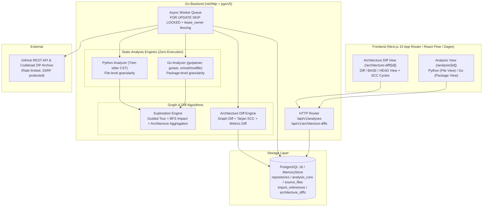

# 12. RepoAtlas Phase 6 — Architecture Diff & Go Language Support 設計書

本書は RepoAtlas Phase 6 における主要機能である **Go Language Support（Go言語の静的解析・探索）** および **Architecture Diff（コミット間アーキテクチャ差分可視化）** の全体アーキテクチャ、データモデル、アルゴリズム、API、およびセキュリティ方針を定義する。

---

## 1. 概要と目的

RepoAtlas は従来、Python リポジトリを対象とした Zero-Execution 静的解析と依存グラフ探索ツールとして提供されてきた。Phase 6 では以下の 2 つの柱によって、**複数言語のコードベースを理解し、その構造の変化を分析できるツール**へと拡張する。

1. **Go Language Support**：
   - GitHub 上の公開 Go リポジトリを入力し、`go.mod` / `go.work` を解析した上で **Package 単位の依存グラフ** を生成。
   - 既存の Python 解析と同じ UI/UX（Guided Code Tour、Impact Analysis、Architecture View、Explainable Evidence）を提供。
   - **Zero-Execution の原則** を厳格に遵守（`go run`, `go build`, `go mod download`, `go list` 等の一切の実行を禁止し、AST 解析と静的テキスト処理のみで完結）。
2. **Architecture Diff**：
   - 同一リポジトリの 2 つのコミット（BASE SHA と HEAD SHA）の依存グラフを比較。
   - ノードの追加・削除・変更（関数数や型定義数の変動）、エッジの追加・削除、循環依存（SCC: Strongly Connected Components）の増減を可視化。
   - React Flow によるカラーコード差分表示（追加=緑、削除=赤、変更=黄、維持=グレー）と 3 つの表示モード（Diff / BASE / HEAD）を提供。

---

## 2. システムアーキテクチャ全体像



---

## 3. Go Language Support 設計

### 3.1 静的解析エンジン選定：Go 標準パーサの採用理由

Go 静的解析には Tree-sitter ではなく、**Go 標準ライブラリ（`go/parser`, `go/ast`, `go/token`, `strconv`）および準標準ライブラリ（`golang.org/x/mod/modfile`）** を採用する。

採用理由：
1. **仕様への完全準拠と高精度**：Go の構文規則、グループ import、alias、blank import、dot import、`//go:build` ディレクティブは Go 言語チームが保守する標準 AST パーサが最も正確に処理できる。
2. **Zero-Execution & 外部バイナリ不要**：ターゲットリポジトリのコードを実行したり `go` コマンド（`go list` 等）を呼び出すことなく、インメモリのソースバイト列から直接 AST を生成可能。
3. **CGO オーバーヘッドの排除**：Tree-sitter Python では CGO が必須であったが、Go 自身の解析は pure Go で完結するため、メモリ消費が極めて小さく並行処理性能が高い。

### 3.2 グラフ粒度：Package 単位（Go）vs File 単位（Python）

Go の仕様上、`import` 文は個別ファイルではなく **Package（Import Path）** を指定する。また同一ディレクトリ内の複数ファイルは同一パッケージを構成し、相互にシンボルを暗黙参照できる。
そのため：
- **Python**：ファイル単位（`NodeID: "file:app/main.py"`）
- **Go**：パッケージ単位（`NodeID: "pkg:github.com/example/myapp/cmd/server"`）

同一パッケージ内の複数ファイルが同一パッケージを import している場合、グラフ上のエッジは 1 本（`Package A -> Package B`）に集約するが、根拠となる各ファイルの import 文（行番号・alias・build tag 等）はすべて `import_references` に保持する。

#### Go Package ノード属性
- `node_id`: `"pkg:" + package_import_path`
- `node_kind`: `"package"`
- `language`: `"go"`
- `module_path`: `go.mod` に定義されたモジュールパス
- `package_import_path`: 完全修飾パッケージインポートパス
- `directory_path`: リポジトリルートからの相対ディレクトリパス
- `package_name`: `package` 宣言の名前（例: `main`, `service`）
- `file_count`: パッケージに属する `.go` ファイル数
- `function_count`: パッケージ全体のトップレベル関数数
- `method_count`: パッケージ全体のレシーバ付きメソッド数
- `type_count`: パッケージ全体の型定義数（struct, interface, type alias）
- `in_degree` / `out_degree`: 依存・被依存パッケージ数
- `importance_score`: 決定論的重要性スコア
- `is_entrypoint_candidate`: `package main` または `cmd/` 配下の場合 `true`
- `files`: パッケージ所属ファイル一覧（パス、関数数、型定義数、ファイルサイズ等）

### 3.3 Go Module (`go.mod` / `go.work`) 解析と依存解決

1. **モジュールインデックスの構築**：
   - リポジトリ直下の `go.mod` およびサブディレクトリのすべての `go.mod` を `golang.org/x/mod/modfile.Parse` で解析。
   - `go.work` が存在する場合、`use` ディレクティブに指定されたローカルモジュールパスを抽出。
   - `replace` ディレクティブの解決：
     - 置換先が `./...` や `../...` など**リポジトリ内に実在する相対パスの場合のみ**内部モジュールとして解決。
     - リポジトリ外のファイルパスや外部ネットワーク参照は一切辿らず、`unresolved` または `external` として扱う。
2. **Package Import Path の導出**：
   - 各 `.go` ファイルの親ディレクトリから、最寄りの祖先ディレクトリにある `go.mod` を検索。
   - `package_import_path = module_path + "/" + rel_dir_from_module_root`
3. **Import 分類**：
   - **`internal`**：リポジトリ内に実在する Package Import Path と完全一致するもの。
   - **`external`**：標準ライブラリ（`fmt`, `net/http` 等）またはリポジトリ外のサードパーティモジュール。
   - **`unresolved`**：複数の競合モジュールで曖昧な場合や解決不能なもの。
4. **ビルド条件（Build Constraints）の保持**：
   - `//go:build`、`// +build`、OS/Arch サフィックス（`*_linux.go` 等）、`_test.go` の情報を各エビデンスに保持。
   - テストファイル限定の import や特定 OS 限定の import にはフラグを付与し、条件付き依存関係であることを明示。

### 3.4 探索機能の Go 対応

- **Guided Code Tour**：
  1. `cmd/` 配下またはルートの `package main`（エントリーポイント）
  2. エントリーポイントから直接参照される主要制御パッケージ（Controller / Orchestrator）
  3. コアドメイン / サービスパッケージ（Service / Domain）
  4. 共有インフラ・リポジトリ・基盤パッケージ（Store / Client / Util）
  - ソート・選出は決定論的に行い、タイブレークは `package_import_path ASC`。
- **Impact Analysis**：
  - パッケージ間の逆方向隣接リストを構築し、幅優先探索（BFS）で直接依存パッケージ（Depth 1）および間接依存パッケージ（Depth 2+）を算出。
  - PR Impact Analysis では変更された `.go` ファイルを親パッケージにマップし、Multi-source BFS を実行。
- **Architecture View**：
  - モジュール単位（複数 `go.mod` の場合）またはトップディレクトリ単位にパッケージを集約表示。

---

## 4. Architecture Diff 設計

### 4.1 コミット間差分の基本要件

- 入力：同一リポジトリの URL、`base_sha` (40文字)、`head_sha` (40文字)。
- BASE と HEAD の両スナップショットの解析が完了した時点で Diff を生成。
- 既存の解析キャッシュ `(repository_id, commit_sha, analyzer_version)` を再利用し、無駄な再解析を排除。

### 4.2 Graph Diff アルゴリズム

グラフ $G_{base} = (V_{base}, E_{base})$ と $G_{head} = (V_{head}, E_{head})$ に対し：

1. **ノード同定のキー**：
   - Python: 相対ファイルパス（例: `app/main.py`）
   - Go: パッケージインポートパス（例: `github.com/example/myapp/cmd/server`）
2. **ノード差分**：
   - 追加ノード $V_{added} = V_{head} \setminus V_{base}$（ステータス: `added`）
   - 削除ノード $V_{removed} = V_{base} \setminus V_{head}$（ステータス: `removed`）
   - 共通ノード $V_{common} = V_{base} \cap V_{head}$：
     - 関数数、クラス/型定義数、入次数、出次数のいずれかが変化 $\to$ ステータス: `modified`
     - 変化なし $\to$ ステータス: `unchanged`
3. **エッジ差分**：
   - エッジキー: `(SourceKey, TargetKey)`
   - 追加エッジ $E_{added} = E_{head} \setminus E_{base}$（ステータス: `added`）
   - 削除エッジ $E_{removed} = E_{base} \setminus E_{head}$（ステータス: `removed`）
   - 維持エッジ $E_{unchanged} = E_{base} \cap E_{head}$（ステータス: `unchanged`）
4. **計算量**：
   - Hash Set / Map を用いることでノード・エッジ差分計算は $O(|V_{base}| + |V_{head}| + |E_{base}| + |E_{head}|)$ で完了。

### 4.3 循環依存差分（Tarjan SCC アルゴリズム）

Tarjan の強連結成分（SCC）アルゴリズムを用いて、$G_{base}$ と $G_{head}$ のそれぞれについて閉路を検出する（計算量 $O(V + E)$）。
- 頂点数が 2 以上の強連結成分（または自己ループ）を「循環依存 SCC」とする。
- BASE と HEAD で循環 SCC の構成ノード集合を比較し、以下を算出：
  - 新たに発生した循環 SCC（`added_cycles`）
  - 解消された循環 SCC（`resolved_cycles`）
  - 継続している循環 SCC（`persistent_cycles`）
  - 循環に関与するノード数の推移（例: 4 $\to$ 2 件）

### 4.4 アーキテクチャ指標（Metrics Diff）

以下の指標について、BASE値、HEAD値、および差分（$\Delta$）を算出：
- Total Nodes（総ノード数）
- Total Edges（総依存エッジ数）
- Added Nodes / Removed Nodes / Modified Nodes
- Added Edges / Removed Edges
- Cyclic SCC Count（循環SCC数）
- Cyclic Nodes Count（循環関与ノード数）
- Average In-Degree / Average Out-Degree
- Maximum In-Degree / Maximum Out-Degree

---

## 5. UI/UX 設計

### 5.1 Architecture Diff ページ (`/architecture-diff/[id]`)

1. **比較入力フォーム**：
   - リポジトリ URL、BASE SHA、HEAD SHA を入力。
   - サンプルコミットペアのワンクリック投入ボタン。
2. **Diff Summary ヘッダー**：
   - BASE SHA $\to$ HEAD SHA のコンパクト表示
   - メトリクス推移バッジ（ノード数変化、エッジ数変化、追加/削除エッジ数、循環SCC変化）
3. **React Flow 差分グラフ可視化**：
   - ノード・エッジの色分け：
     - **Added**：エメラルドグリーン（`#10b981`）
     - **Removed**：ローズレッド（`#ef4444`）
     - **Modified**：アンバーイエロー（`#f59e0b`）
     - **Unchanged**：ニュートラルスレート（`#64748b`）
   - 3 つの表示モード切り替え：
     - **Diff View**：全ノード・エッジの差分統合表示
     - **BASE View**：BASE コミット時点のグラフ
     - **HEAD View**：HEAD コミット時点のグラフ
   - レイアウト安定性：
     - 統合グラフ上で Dagre 座標を決定し、BASE / HEAD / Diff の切り替え時に共通ノードがジャンプしない安定レイアウトを維持。
4. **差分フィルタ**：
   - Show all / Added only / Removed only / Modified only / Cyclic dependencies only
5. **差分詳細サイドパネル**：
   - 選択されたノード/エッジの変更内容、BASE側とHEAD側のメトリクス比較、追加・削除された import エビデンス、GitHub 該当コミットへのソースリンク。

---

## 6. DB スキーマ設計（Migration）

既存の `analysis_runs`、`source_files`、`import_references` の後方互換性を保ちながら、以下のテーブルとカラムを追加する。

### 6.1 `architecture_diffs` テーブル
```sql
CREATE TABLE architecture_diffs (
    id UUID PRIMARY KEY DEFAULT gen_random_uuid(),
    repository_id BIGINT NOT NULL REFERENCES repositories(id) ON DELETE CASCADE,
    base_sha CHAR(40) NOT NULL,
    head_sha CHAR(40) NOT NULL,
    base_analysis_id UUID REFERENCES analysis_runs(id) ON DELETE SET NULL,
    head_analysis_id UUID REFERENCES analysis_runs(id) ON DELETE SET NULL,
    analyzer_version TEXT NOT NULL,
    diff_algorithm_version TEXT NOT NULL DEFAULT 'v1.0.0',
    status TEXT NOT NULL DEFAULT 'queued'
        CHECK (status IN ('queued', 'running', 'completed', 'failed')),
    stage TEXT NOT NULL DEFAULT 'queued',
    attempt_count INTEGER NOT NULL DEFAULT 0 CHECK (attempt_count >= 0),
    lease_owner TEXT,
    lease_expires_at TIMESTAMPTZ,
    error_code TEXT,
    error_message TEXT,
    diff_summary JSONB,
    created_at TIMESTAMPTZ NOT NULL DEFAULT now(),
    completed_at TIMESTAMPTZ,
    CONSTRAINT architecture_diffs_base_sha_format CHECK (base_sha ~ '^[0-9a-f]{40}$'),
    CONSTRAINT architecture_diffs_head_sha_format CHECK (head_sha ~ '^[0-9a-f]{40}$'),
    CONSTRAINT architecture_diffs_unique_comparison UNIQUE (repository_id, base_sha, head_sha, analyzer_version, diff_algorithm_version)
);

CREATE INDEX architecture_diffs_queue_idx
    ON architecture_diffs (status, lease_expires_at, created_at);
```

### 6.2 既存テーブルの拡張
- `analysis_runs`:
  - `language TEXT NOT NULL DEFAULT 'python'`
  - `graph_granularity TEXT NOT NULL DEFAULT 'file'`
- `source_files`:
  - `node_kind TEXT NOT NULL DEFAULT 'file'`
  - `module_path TEXT`
  - `package_import_path TEXT`
  - `directory_path TEXT`
  - `package_name TEXT`
  - `files_count INTEGER NOT NULL DEFAULT 1`
  - `methods_count INTEGER NOT NULL DEFAULT 0`
  - `types_count INTEGER NOT NULL DEFAULT 0`
  - `metadata JSONB`
- `import_references`:
  - `source_file TEXT`
  - `alias TEXT`
  - `column_number INTEGER NOT NULL DEFAULT 1`
  - `build_constraints TEXT`
  - `evidence_metadata JSONB`

---

## 7. API エンドポイント設計

### 7.1 新規エンドポイント
- `POST /api/v1/architecture-diffs`
  - リクエスト:
    ```json
    {
      "repository_url": "https://github.com/owner/repo",
      "base_sha": "a1b2c3d...",
      "head_sha": "e4f5a6b..."
    }
    ```
  - レスポンス:
    ```json
    {
      "diff_id": "uuid",
      "status": "queued",
      "cached": false
    }
    ```
- `GET /api/v1/architecture-diffs/{id}`
  - ステータス、進行度、サマリー、メトリクス差分を返却。
- `GET /api/v1/architecture-diffs/{id}/graph`
  - 差分グラフ（ノード・エッジの変更ステータス、SCC 循環差分、エビデンス）を返却。

### 7.2 既存エンドポイントの拡張
- `POST /api/v1/analyses`:
  - オプションパラメータ `"language": "auto" | "python" | "go"` を追加（デフォルトは auto 検出）。
- `GET /api/v1/analyses/{id}/graph`:
  - レスポンスに `language` (`"python"` | `"go"`), `graph_granularity` (`"file"` | `"package"`), `node_kind` を追加。

---

## 8. セキュリティ・Zero-Execution 保証

1. **Zero-Execution 原則**：
   - Go ソースおよびモジュール定義の解析には標準 AST パーサおよびテキストパーサのみを使用。
   - `go run`, `go build`, `go test`, `go mod download`, `go list`, `go get` 等の一切の外部コマンド実行を禁止。
2. **ZIP 展開・リソース制限**：
   - 最大 ZIP 圧縮サイズ: 50 MiB
   - 最大展開後合計サイズ: 100 MiB
   - 最大単一ファイルサイズ: 1 MiB
   - 最大ソースファイル合計サイズ: 20 MiB
   - 最大ファイル数: 2,000 件
   - パストラバーサル（`..`）およびシンボリックリンクの完全拒否
3. **SSRF 防御とトークン保護**：
   - GitHub 公式ドメイン（`api.github.com`, `codeload.github.com` 等）への HTTPS 通信のみ許可。
   - ログ出力時の GitHub トークン（`ghp_*`, `github_pat_*`）自動マスキング。
