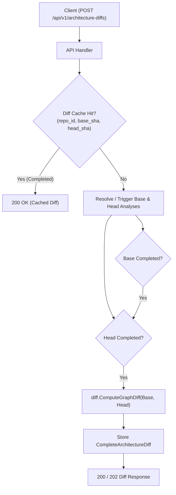

# RepoAtlas — Architecture Diff & Cycle Evolution

## 1. 概要 (Overview)

**Architecture Diff** は、同一リポジトリの任意の2つのGitコミット（`BASE` と `HEAD`）における依存グラフを比較し、コードベースのアーキテクチャ変化を視覚的に特定・可視化する機能です。
単なる行ベースのGit Diff（コード差分）とは異なり、システム全体の構造的健全性、モジュール間結合度の増減、および**循環依存（Cyclic Dependency）の発生・解消**を $O(V + E)$ の計算量で決定論的に算出します。

---

## 2. スナップショット解析とキャッシュ再利用



### キャッシュキー
Diff結果は以下の複合キーで一意にキャッシュされます：
- `repository_id`
- `base_commit_sha`
- `head_commit_sha`
- `analyzer_version`
- `diff_algorithm_version`

BASEおよびHEADの各コミットの静的解析結果（`analysis_runs`）が既に完了している場合、**一切の再解析を行わずに即座にグラフ差分を生成**します。

---

## 3. グラフ差分アルゴリズム ($O(V + E)$)

### 3.1 ノード差分 (Node Diff)
ノードID（Python: `file:<path>`, Go: `pkg:<import_path>`）をキーとして、BASE集合とHEAD集合の積集合・差集合を求めます。

- **Added (追加)**: HEADのみに存在
- **Removed (削除)**: BASEのみに存在
- **Modified (変更)**: 双方に存在し、内部メトリクス（関数数、クラス/型数、依存先・被依存先、重要度スコア）のいずれかに変動がある
- **Unchanged (不変)**: 双方に存在し、メトリクスおよび入出力依存が一致

### 3.2 エッジ差分 (Edge Diff)
エッジID（`source -> target`）をキーとして差分を判定します。
- **Added Edge**: HEADで新規に追加された依存
- **Removed Edge**: HEADで削除された依存
- **Unchanged Edge**: 双方で維持された依存

---

## 4. 循環依存（SCC）差分アルゴリズム

循環依存の検知には、**Tarjan の強連結成分分解（Strongly Connected Components, SCC）アルゴリズム**を採用しています。
Tarjanアルゴリズムはグラフを1回の深さ優先探索（DFS）で巡回するため、計算量は線形時間 **$O(V + E)$** です。

### 4.1 循環成分の抽出
サイズが2以上の強連結成分、または自己参照エッジ（$u \to u$）を持つ成分を「循環依存コンポーネント（Cyclic Component）」として抽出します。各成分内のノード順序を決定論的にソートして正規化します。

### 4.2 循環の推移分類 (Cycle Changes)
BASEコミットの循環成分集合 $C_{BASE}$ と、HEADコミットの循環成分集合 $C_{HEAD}$ を比較します。

```text
1. Added Cycles (新規発生した循環依存):
   C ∈ C_HEAD かつ C ∉ C_BASE
   -> アーキテクチャの悪化・技術的負債の混入リスクを警告 (⚠️ Red Alert)

2. Resolved Cycles (解消された循環依存):
   C ∈ C_BASE かつ C ∉ C_HEAD
   -> リファクタリングによる結合度改善を評価 (✅ Green Badge)

3. Persistent Cycles (持続する循環依存):
   C ∈ C_BASE かつ C ∈ C_HEAD
   -> 既存の循環依存として記録
```

---

## 5. アーキテクチャ・メトリクス差分

BASEとHEADの各指標を比較し、サマリー統計（`metrics`）を算出します：

| 指標名 | 説明 | 健全性の解釈 |
| :--- | :--- | :--- |
| `total_nodes` | 総ノード数（ファイル / パッケージ）の推移 | 規模の変化 |
| `total_edges` | 総依存本数の推移 | 結合度の総量 |
| `cyclic_scc_count` | 循環強連結成分（SCC）の個数推移 | **減少が望ましい** |
| `cyclic_nodes_count`| 循環依存に巻き込まれているノード総数 | **減少が望ましい** |
| `avg_in_degree` / `avg_out_degree` | 平均被依存数 / 平均依存先数 | モジュール結合密度の変化 |
| `max_in_degree` / `max_out_degree` | 最大被依存数 / 最大依存先数 | ボトルネック・神クラスの出現検知 |

---

## 6. フロントエンド可視化と安定レイアウト (Stable Dagre Layout)

React Flowによる差分可視化では、以下の要件を満たす専用UIコンポーネントを提供しています：

### 6.1 統一レイアウト（Union Graph Layout）
BASE / HEAD / Diff の3つの表示モードを切り替えた際にノードの座標が激しくジャンプすると、ユーザーの空間的認知が乱れます。
RepoAtlasでは、**BASEノードとHEADノードの和集合（Union Graph）に対してDagreレイアウトを一度だけ計算**し、各表示モードでは表示対象外のノードをフィルタリング・非表示化することで、**ノード位置が完全に固定された安定した視覚体験**を実現しています。

### 6.2 3つの表示モード (View Modes)
1. **Diff View**: 追加（緑色）、削除（赤色点線）、変更（黄色）、不変（スレート色）を色分けし、全変化を一目で俯瞰。
2. **BASE View**: 変更前のコミット時点での構造スナップショット。
3. **HEAD View**: 変更後のコミット時点での構造スナップショット。

### 6.3 差分フィルター (Filter Bar)
- **すべて表示 (All)**
- **追加のみ (+)**: 新規パッケージ/モジュールのみをハイライト
- **削除のみ (-)**: 削除された古いパッケージをハイライト
- **変更のみ (~)**: 内部実装や結合度が変動したノードをハイライト
- **循環依存のみ (Cyclic)**: SCCに含まれるノード・エッジのみを抽出し、循環経路を表示

---

## 7. HTTP API エンドポイント

### 7.1 Diff作成リクエスト
`POST /api/v1/architecture-diffs`
```json
{
  "repository_url": "https://github.com/spf13/cobra",
  "base_sha": "2077efab5d203e8ff60293674fe8c6ef1fcad243",
  "head_sha": "cd378035b3769971bc18bfb672778c187be06ad9"
}
```
**Response (202 Accepted または 200 OK cached):**
```json
{
  "diff_id": "9b1deb4d-3b7d-4bad-9bdd-2b0d7b3dcb6d",
  "status": "completed",
  "cached": true
}
```

### 7.2 Diffステータス取得
`GET /api/v1/architecture-diffs/{id}`

### 7.3 Diffグラフ取得
`GET /api/v1/architecture-diffs/{id}/graph`
全ノード（`change_type`, `base_metrics`, `head_metrics`, `change_details`）、全エッジ（`change_type`, `is_cyclic`）、循環推移（`cycle_changes`）を返却します。
